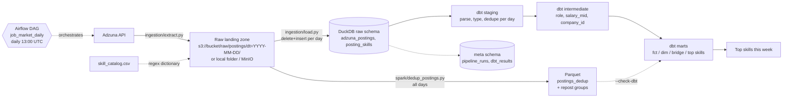
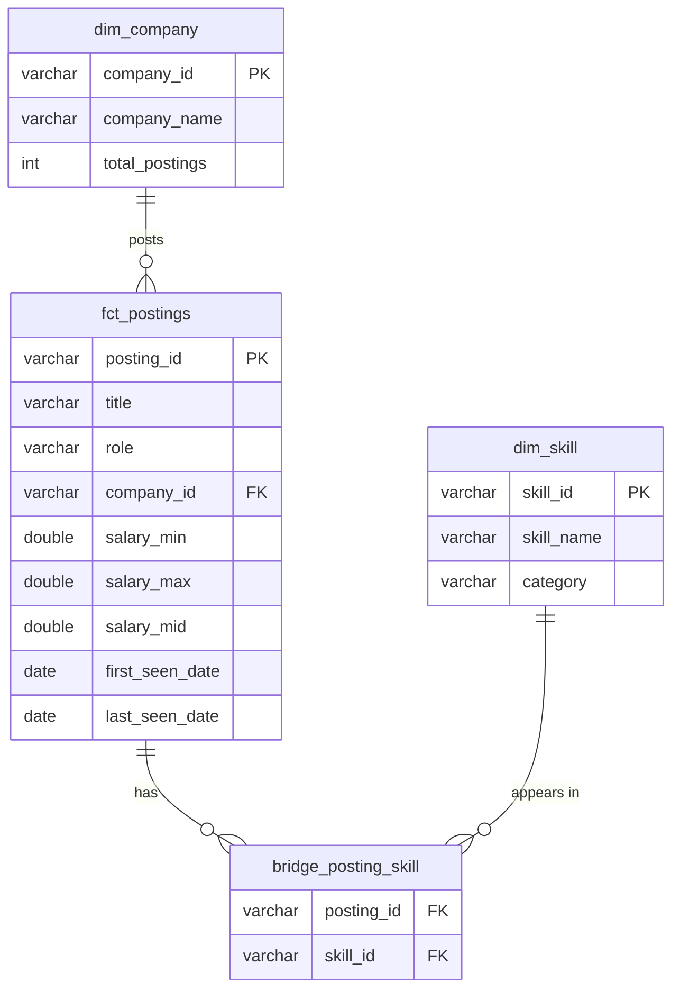

# Job Market Data Pipeline

Daily ingestion of US data/analytics job postings from the [Adzuna API](https://developer.adzuna.com/)
to analyze skill demand, salaries and hiring trends.

**Status:** running on real Adzuna data with an S3 raw landing zone, Airflow orchestration and a
PySpark cross-day dedup job. Dashboard and CI are next.

## Architecture



Planned next: a Streamlit dashboard, CI, and optionally Snowflake.

## Data model



`mart_top_skills_by_role_week` aggregates these to one row per week, role and skill.

## Setup

Requirements: Python 3.11 to 3.13, git. (Docker is only needed from Stage 2/3.)

```bash
git clone https://github.com/khus-hi/job-market-data-pipeline.git && cd job-market-data-pipeline
python -m venv .venv
source .venv/bin/activate          # Windows: .venv\Scripts\activate
pip install -r requirements-dev.txt
cp .env.example .env               # Windows: copy .env.example .env
# then put your Adzuna app_id / app_key in .env
```

Mac notes: use Python from python.org (Apple's built-in `python3` is too old), create the venv
with `python3.13 -m venv .venv`, and run `"/Applications/Python 3.13/Install Certificates.command"`
once after installing Python, or `pip install` fails with `CERTIFICATE_VERIFY_FAILED`.
Every new terminal needs `source .venv/bin/activate` before `python`/`pip` work.

Raw files land in a local folder by default. To land them in S3, follow
[docs/aws-setup.md](docs/aws-setup.md) (bucket, least-privilege IAM user, zero-spend budget,
teardown) and set `STORAGE_BACKEND=s3` in `.env`.

Run in Airflow (Docker + Astro CLI): `astro dev start`, then open the Airflow UI URL it prints. See
[docs/airflow.md](docs/airflow.md) for retries, the SLA, and backfills.

Run one day from the command line:

```bash
python -m ingestion.pipeline --source sample   # fake data, no keys needed
python -m ingestion.pipeline                   # real Adzuna data for today
python -m ingestion.report                     # print top skills this week
python -m pytest                               # unit tests
```

Spark dedup job (needs Java, see [docs/spark.md](docs/spark.md)):
`pip install -r requirements-spark.txt`, then `python -m spark.dedup_postings --check-dbt`.

Sample data is invented (companies like "Acme Analytics", IDs starting with `sample-`). Never quote
numbers from sample runs. Delete `data/` before your first real run so the two don't mix.

## Design decisions

**ELT, raw first.** The API response is saved as untouched JSON, then loaded verbatim into
`raw.adzuna_postings.payload`. All parsing lives in dbt. If a parsing bug is found later we fix the
SQL and rebuild from raw, with no need to call the API again (Adzuna can't return past days anyway).

**Idempotency at every layer.** Re-running a day must not duplicate data:
- *Extract* fetches every page into memory first, then replaces that day's partition. Locally that
  is a temp-folder swap. In S3, which has no atomic rename, it uploads every file (same key =
  overwrite) and then deletes keys left over from an earlier run of that day.
- *Load* does `delete where snapshot_date = ?` + `insert` inside one transaction.
- *dbt* `fct_postings` is incremental with `unique_key=posting_id` (delete+insert), so a posting seen
  again replaces its row instead of adding one.

**Incremental loads.** `fct_postings` only rebuilds postings touched by the last `lookback_days`
(default 3) of snapshots: those seen in the window, plus those the table says were last seen in the
window. Each is recomputed from its full snapshot history, so `first_seen_date` stays correct, and a
post-hook removes rows that no longer have any snapshot in the window. Backfilling a day older than
the window needs `--full-refresh`.

The second half of that rule came from a real bug. Re-loading a day for which the API returned a
*different* set of postings left the vanished postings in the fact table, because a merge on
`posting_id` only touches keys that are still present. The `relationships` test from
`fct_postings.company_id` to `dim_company` caught it on a real run. Verified fix: after removing a
third of two days' postings and rebuilding incrementally, the table matches a `--full-refresh`
build exactly (the old logic left 46 rows different).

**Pluggable raw storage.** `extract.py` and `load.py` depend on a small `RawStore` interface
(`write_partition`, `read_partition`, `list_partitions`), with `LocalStore` and `S3Store`
implementations. Switching backends is a config change. MinIO works through the same `S3Store`
by setting `S3_ENDPOINT_URL`. The test suite runs every extract and load test against both a local
folder and a mocked S3 bucket (moto), so the backends are proven to behave the same.

**S3 layout and security.** Hive-style `dt=YYYY-MM-DD` partitions, so Spark, Athena and DuckDB can
prune by date. The bucket blocks all public access, and the pipeline's IAM user can only list, read,
write and delete under `raw/` in that one bucket ([policy](infra/iam-policy-raw-landing.json)).
Keys live in the gitignored `.env`, never in code.

**Orchestration (Airflow 3 via Astro).** One task per step (extract, load, dbt build, freshness,
SLA check), so a failure retries only that step and the UI shows where a run broke. The task code
calls the same `ingestion/steps.py` functions as the CLI, so there's one implementation. Retries
use exponential backoff for the flaky API call and are disabled for dbt, because a failing data
test isn't fixed by retrying. `max_active_runs=1` because DuckDB has a single writer. dbt runs in
its own virtualenv inside the image, so its dependencies can't clash with Airflow's.

**Backfills that respect the source.** Adzuna can't return past days, so the extract task fetches
only for today. For a past date it reuses the raw files landed that day, or fails without retries
if there are none. A backfill therefore re-processes real history and never invents it.

**Grain.** Raw: one row per posting per page fetched. Staging: one posting per snapshot day.
`fct_postings`: one row per posting, ever. Each grain is enforced with a `unique_combination` test.

**dbt layers.** *Staging* renames and casts only. *Intermediate* holds business logic (role from
title, salary midpoint, company key). *Marts* are the tables people query. Each layer has one job,
so a bug is easy to locate.

**Skill extraction in Python, catalog in a dbt seed.** One CSV (`dbt/seeds/skill_catalog.csv`)
drives both the regex extractor and `dim_skill`. Python because regex edge cases (NoSQL vs SQL,
JavaScript vs Java, "excel at" vs Excel, R&D vs R) deserve real unit tests.

**Role from title, not from the search term.** One posting can come back under several searches.
The `classify_role` macro buckets the title into five roles, tested with `accepted_values`.

**Spark for cross-day dedup, SQL for everything else.** `spark/dedup_postings.py` reads every
day's raw JSON from the landing zone, collapses repeat sightings to one row per posting, and groups
reposts (same company, title and location under a new id within 14 days) with a sessionisation
window. The first half duplicates dbt's `fct_postings` on purpose, and `--check-dbt` verifies the
two agree. At this data size DuckDB is faster (the Spark run is mostly JVM startup), so dbt stays
the main path. [docs/spark.md](docs/spark.md) explains when Spark would be worth it.

**Known limits.** Adzuna truncates descriptions (about 500 characters), so skill counts are a lower
bound. Company identity is name-based (Adzuna has no company ID). A snapshot date is the day we
fetched, not the day the job was posted.

## Data quality

Every run writes to the `meta` schema:
- `meta.pipeline_runs`: rows and seconds for each step (extract, load, dbt_build, freshness, total,
  sla, spark_dedup)
- `meta.dbt_results`: every dbt model and test result, with failure counts

Tests: `unique`, `not_null`, `accepted_values`, `relationships`, source freshness, two custom
generic tests (`unique_combination`, `column_a_lte_column_b`) and one singular test.

## What I'd do at 10x scale

- **Raw zone:** keep the `dt=` partitions, but compact each day's small JSON files into one
  Parquet file, so readers scan columns instead of parsing JSON.
- **Spark:** run the dedup job on a cluster (EMR Serverless or Databricks) reading `s3a://`
  directly, and process only new days by merging into a table format (Iceberg or Delta) instead
  of rewriting all history.

_More to come as the remaining stages land._

## Résumé metrics

Measured from real Adzuna runs only, never estimated. Updated as more real runs happen.

| Metric | Value | Source |
|---|---|---|
| Postings fetched per daily run | 567 rows, 553 unique postings (first real run, 2026-11-07) | `meta.pipeline_runs`, step `load`; `marts.fct_postings` |
| End-to-end runtime | 31.5 s (28.3 s of it is deliberate API throttling) | `meta.pipeline_runs`, step `total` |
| Spark cross-day dedup | 1,126 raw sightings → 912 unique postings → 875 distinct jobs (37 reposts) over 2 days, 8.3 s; matches dbt `fct_postings` with 0 differing rows | `meta.pipeline_runs`, step `spark_dedup`; `--check-dbt` |
| dbt tests | 32 data tests | `dbt build` output |
| pytest tests | 63 | `pytest` output |
| Cloud cost | $0 so far | AWS Billing |

Queries to pull them:

```sql
select snapshot_date, row_count from meta.pipeline_runs where step = 'load' order by 1;
select snapshot_date, seconds from meta.pipeline_runs where step = 'total' order by 1;
```
