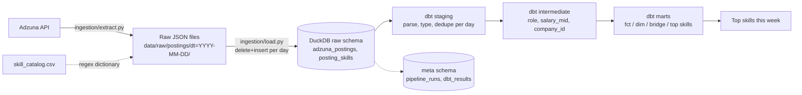
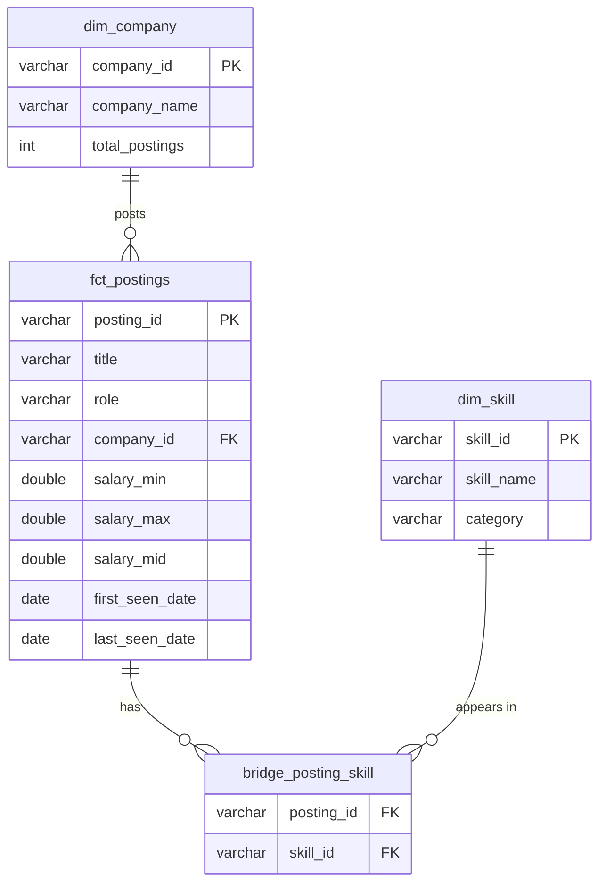

# Job Market Data Pipeline

Daily ingestion of US data/analytics job postings from the [Adzuna API](https://developer.adzuna.com/)
to analyze skill demand, salaries and hiring trends. Built stage by stage as a portfolio project.

**Status:** Stage 1 (local MVP) running on real data. See [PROGRESS.md](PROGRESS.md) and the
[Stage 1 walkthrough](docs/stage-1-walkthrough.md).

## Architecture



Later stages swap the local raw folder for S3 (Stage 2), add Airflow (3), a PySpark dedup job (4),
a Streamlit dashboard (5), CI (6) and optionally Snowflake (7).

## Data model



`mart_top_skills_by_role_week` aggregates these to one row per week, role and skill.

## Setup

Requirements: Python 3.11 to 3.13, git. (Docker is only needed from Stage 2/3.)

```bash
git clone https://github.com/khus-hi/job-market-data-pipeline.git && cd job-market-data-pipeline
python -m venv .venv
source .venv/bin/activate          # Windows: .venv\Scripts\activate
pip install -r requirements.txt
cp .env.example .env               # Windows: copy .env.example .env
# then put your Adzuna app_id / app_key in .env
```

Mac notes: use Python from python.org (Apple's built-in `python3` is too old), create the venv
with `python3.13 -m venv .venv`, and run `"/Applications/Python 3.13/Install Certificates.command"`
once after installing Python, or `pip install` fails with `CERTIFICATE_VERIFY_FAILED`.
Every new terminal needs `source .venv/bin/activate` before `python`/`pip` work.

Run one day:

```bash
python -m ingestion.pipeline --source sample   # fake data, no keys needed
python -m ingestion.pipeline                   # real Adzuna data for today
python -m ingestion.report                     # print top skills this week
python -m pytest                               # unit tests
```

Sample data is invented (companies like "Acme Analytics", IDs starting with `sample-`). Never quote
numbers from sample runs. Delete `data/` before your first real run so the two don't mix.

## Design decisions

**ELT, raw first.** The API response is saved as untouched JSON, then loaded verbatim into
`raw.adzuna_postings.payload`. All parsing lives in dbt. If a parsing bug is found later we fix the
SQL and rebuild from raw, with no need to call the API again (Adzuna can't return past days anyway).

**Idempotency at every layer.** Re-running a day must not duplicate data:
- *Extract* writes into `dt=…tmp/` and swaps it in, replacing that day's folder.
- *Load* does `delete where snapshot_date = ?` + `insert` inside one transaction.
- *dbt* `fct_postings` is incremental with `unique_key=posting_id` (delete+insert), so a posting seen
  again replaces its row instead of adding one.

**Incremental loads.** `fct_postings` only reprocesses the last `lookback_days` (default 3) of
snapshots, and keeps the earliest `first_seen_date` already in the table. Verified on sample data:
an incremental build produces exactly the same table as `--full-refresh`. Backfilling a day older
than the lookback window needs `--full-refresh`.

**Grain.** Raw: one row per posting per page fetched. Staging: one posting per snapshot day.
`fct_postings`: one row per posting, ever. Each grain is enforced with a `unique_combination` test.

**dbt layers.** *Staging* renames and casts only. *Intermediate* holds business logic (role from
title, salary midpoint, company key). *Marts* are the tables people query. Each layer has one job,
so a bug is easy to locate.

**Skill extraction in Python, catalog in a dbt seed.** One CSV (`dbt/seeds/skill_catalog.csv`)
drives both the regex extractor and `dim_skill`. Python because regex edge cases (NoSQL vs SQL,
JavaScript vs Java, "excel at" vs Excel, R&D vs R) deserve real unit tests.

**Role from title, not from the search term.** One posting can come back under several searches.
The `classify_role` macro buckets the title into five roles, tested with `accepted_values`.

**Known limits.** Adzuna truncates descriptions (about 500 characters), so skill counts are a lower
bound. Company identity is name-based (Adzuna has no company ID). A snapshot date is the day we
fetched, not the day the job was posted.

## Data quality

Every run writes to the `meta` schema:
- `meta.pipeline_runs`: rows and seconds for each step (extract, load, dbt_build, freshness, total)
- `meta.dbt_results`: every dbt model and test result, with failure counts

Tests: `unique`, `not_null`, `accepted_values`, `relationships`, source freshness, two custom
generic tests (`unique_combination`, `column_a_lte_column_b`) and one singular test.

## What I'd do at 10x scale

_To be written as the stages progress (S3 partitioning, Spark, warehouse choice)._

## Résumé metrics

Measured from real Adzuna runs only, never estimated. Updated as more real runs happen.

| Metric | Value | Source |
|---|---|---|
| Postings fetched per daily run | 567 rows, 553 unique postings (first real run, 2026-11-07) | `meta.pipeline_runs`, step `load`; `marts.fct_postings` |
| End-to-end runtime | 31.5 s (28.3 s of it is deliberate API throttling) | `meta.pipeline_runs`, step `total` |
| dbt tests | 32 data tests (Stage 1) | `dbt build` output |
| pytest tests | 29 (Stage 1) | `pytest` output |
| Cloud cost | $0 (Stage 1 is fully local) | |

Queries to pull them:

```sql
select snapshot_date, row_count from meta.pipeline_runs where step = 'load' order by 1;
select snapshot_date, seconds from meta.pipeline_runs where step = 'total' order by 1;
```
